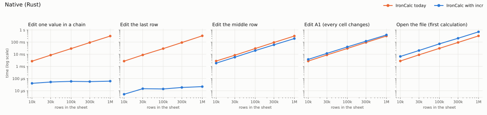
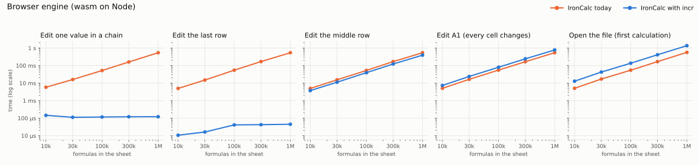

# Incremental recalculation for IronCalc

This branch adds an optional incremental evaluator to IronCalc, built on the
[incr](https://crates.io/crates/incr-compute) library. Today every edit
recalculates the whole workbook, so edits get slower as a sheet grows. With
the evaluator on, an edit recomputes only the formulas that depend on the
changed cell, and its cost follows the size of the change rather than the
size of the sheet.

It is a prototype behind a cargo feature (`incr`, off by default). With the
feature off, IronCalc builds and behaves exactly as it does upstream.

## Results

Median time per edit (or per first calculation) against sheet size, on an
Intel i7-9750H laptop (`data/machine.txt`). "IronCalc today" is the shipped evaluator handling the
same edit on the same workbook.





At 1,000,000 rows (990,000 formulas in *chains*, 1,000,000 in the *running sum*):

| Edit | Native today | Native with incr | wasm today | wasm with incr |
|---|---|---|---|---|
| One value in a chain | 314 ms | **0.061 ms** (5,100x faster) | 542 ms | **0.12 ms** (4,500x faster) |
| The last row | 329 ms | **0.022 ms** (15,000x faster) | 541 ms | **0.045 ms** (12,000x faster) |
| The middle row (half the sums change) | 317 ms | **196 ms** (1.6x faster) | 540 ms | **393 ms** (1.4x faster) |
| A1 (every sum changes) | 317 ms | 389 ms (1.23x slower) | 544 ms | 781 ms (1.44x slower) |
| First calculation after opening | 324 ms | 699 ms (2.2x slower) | 568 ms | 1,369 ms (2.4x slower) |

Each figure is a median of 30 edits by each evaluator, or of 10 first
calculations each. The two evaluators are timed one step each in turn, so a
change in machine load reaches both alike. A full recalculation between
incremental edits also flushes the CPU caches, so the smallest incremental
edits read slower here than when timed alone: the performance gate times the
last-row edit alone at 0.0013 ms natively at 400,000 rows (`data/gate-native.txt`).
The raw numbers are in `data/`.

The workbooks are synthetic and match the ones in `base/benches/incr_common`:
*chains* is numbers in column A with formulas in B forming 100-row chains, and
*running sum* is `B1 = A1`, `B(r) = B(r-1) + A(r)`, where an edit to row r
changes every sum below it.

## What it costs

- **Opening a file:** the first calculation builds the dependency graph, so it
  takes about 2.2x as long natively and 2.4x in wasm.
- **Edits that change nearly everything:** an edit that every formula depends
  on costs about 1.2x the shipped evaluator natively and 1.4x in wasm, since
  incr does the same work plus its bookkeeping.
- **Dynamic arrays and circular references:** these are not evaluated
  incrementally. Spills depend on the order of evaluation, so a recalc that
  reaches a dynamic array, a cycle, or a formula that reads one runs the
  shipped evaluation once and takes its values, and costs what it costs today.
- **Memory:** about 340 bytes per formula and 137 per referenced constant
  natively, and 284 and 113 in wasm (32-bit pointers), on top of the workbook,
  measured by the performance gate (`data/gate-native.txt`, `data/gate-node.txt`).

## Same answers as the shipped evaluator

A lockstep differential runs the incremental model and the shipped one side by
side and compares a snapshot of every cell after every edit: values and their
error details, spills, links, conditional-format caches, array anchors and the
restart count. It runs over every workbook `xlsx/build.rs` turns into tests
(`tests/calc_tests`, `tests/calc_test_no_export`, `tests/templates`, and
`tests/docs` minus the five it skips) with eight seeds of 40
random edits each (constants, formulas, copies of the workbook's own formulas,
clears, CSE and dynamic arrays, cycles, undo and redo, structural and
metadata edits), at the normal evaluation depth and at depth 1, natively, and
with seeds 1 and 2 in the wasm build on Node. It reports no difference on this branch, and the full
test suite passes with the feature on and off.

## Try it

```sh
git clone -b incr https://github.com/Anyesh/IronCalc.git
cd IronCalc

# The size sweep behind the charts, natively and on Node (needs wasm-pack).
cargo bench -p ironcalc_base --features incr --bench incr_sweep
make -C bindings/wasm bench-sweep
uv run --with matplotlib python incr/plot_sweep.py native node

# The lockstep differential and the suite with the evaluator on.
make test-incr
```

`INCR_SWEEP_ROWS=10000,100000` picks the sizes. In code, switch a model over
with `model.set_incremental(true)` (`setIncremental(true)` on the wasm
`Model`); every later `evaluate()` is incremental.

## Status

- Built on IronCalc v0.9.0 (15 October 2026) and incr-compute 0.2.0-beta.6
  from crates.io.
- The Python and Node packages do not enable the feature; the wasm build
  exposes the switch hidden from the typings.
- Writes made directly through `Model.workbook`, bypassing the model's
  setters, are not seen by the incremental evaluator in release builds, as
  they already bypass the shipped parsed-structure caches.
